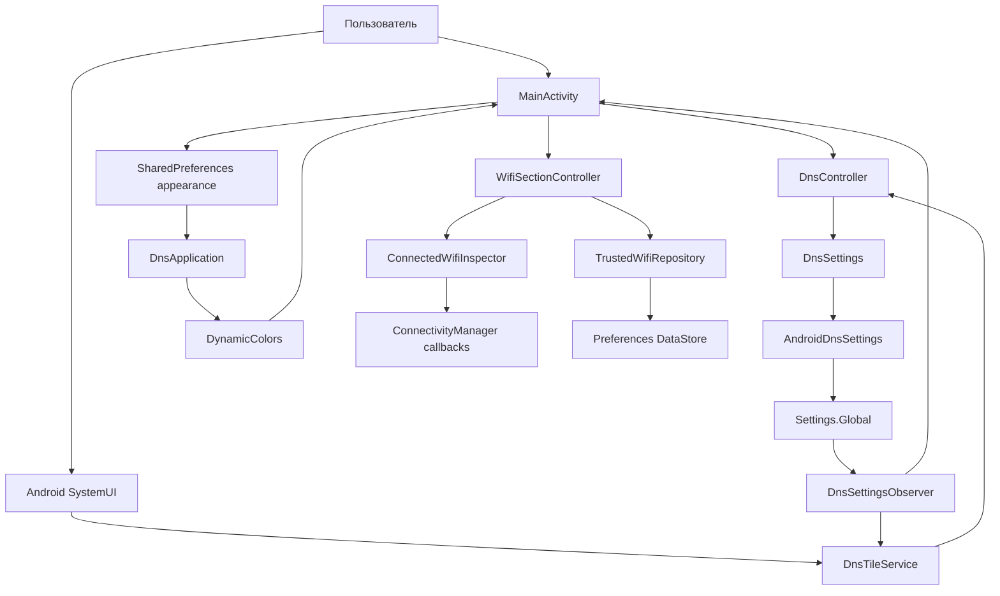

# Архитектура pDNS Auto Switch

Документ описывает текущую реализацию. Постоянная автоматизация по сети пока не реализована.

## Назначение и границы

Приложение управляет системным Android Private DNS: вручную переключает сохранённого
провайдера и выключенный режим кнопкой или плиткой Quick Settings **Smart DNS**.

Оно не является DNS-сервером, VPN или прокси, не резолвит запросы самостоятельно и не проверяет
доступность провайдера. Состояние «Включён» означает выбранный режим `hostname` в Android.
Есть проверка подключённого Wi-Fi по кнопке и локальный список доверенных SSID. Постоянного мониторинга, foreground service и автозапуска нет; список пока не влияет на DNS.

## Стек и сборка

| Параметр | Текущее значение |
|---|---|
| Модуль | `app` |
| Язык и UI | Kotlin, XML Views, AppCompat, Material 3 |
| Application ID / namespace | `io.github.sorjo.pdnsautoswitch` |
| Поддерживаемый минимум | Android 13 / API 33 |
| compileSdk / targetSdk | 37 / 37 |
| Android Gradle Plugin | 9.1.1, встроенная поддержка Kotlin |
| Gradle Wrapper | 9.3.1 |
| JVM для Gradle daemon | 25, задана в `gradle/gradle-daemon-jvm.properties` |
| Java / Kotlin bytecode target | 17 |
| Material Components | 1.13.0 |
| Тесты | JUnit 4.13.2, локальные JVM-тесты |
| Хранилище доверенных сетей | Preferences DataStore 1.2.1 |

Версия APK задаётся в `app/build.gradle.kts`; не дублировать здесь историю версий.
Путь SDK локален для машины и находится в игнорируемом `local.properties`.
Release использует отдельный постоянный ключ: реквизиты читаются из внешнего файла,
заданного `PDNS_SIGNING_PROPERTIES`. Без него release не проходит проверку подписи.
Подробности — в [инструкции сборки](docs/release-build.md).

## Компоненты и связи

Исходники расположены в `app/src/main/java/io/github/sorjo/pdnsautoswitch/`.

| Компонент | Ответственность |
|---|---|
| `DnsController` | Читает состояние, определяет целевой режим, проверяет условия записи и её результат. Не зависит от Android API. |
| `DnsSettings` | Интерфейс чтения, записи и проверки разрешения; граница между логикой и Android. |
| `AndroidDnsSettings` | Реализует интерфейс через `Settings.Global` и проверку `WRITE_SECURE_SETTINGS`. |
| `DnsSettingsObserver` | Подписывается на изменения трёх DNS-ключей через `ContentObserver` на main looper. |
| `DnsTileService` | Показывает системное состояние, обрабатывает нажатие и разблокировку, направляет к настройке при ошибках. |
| `MainActivity` | Экран состояния и переключения, выдачи инструкции, добавления плитки и выбора палитры. |
| `DnsApplication` | Регистрирует применение динамической палитры к Activity с учётом настройки пользователя. |

`WifiSectionController` управляет проверкой, runtime-разрешением и списком в Activity.
`ConnectedWifiInspector` регистрирует callback только на короткое окно проверки (2 секунды),
использует `FLAG_INCLUDE_LOCATION_INFO` и `WifiInfo` из `NetworkCapabilities.transportInfo`.
Запрос ограничен физическими Wi-Fi (`NOT_VPN`), не создаёт соединение и не сканирует эфир.
Обрабатываются `onAvailable`, `onCapabilitiesChanged` и `onLost`; результат может содержать
несколько сетей или скрытые SSID. Это диагностический снимок, не выбор сети для будущего Auto.
Проверка отменяется в `onPause`, её UI-контроллер и coroutine scope закрываются в `onDestroy`.

`WifiSsid` снимает только внешние framework-кавычки, отбрасывает пустое/неизвестное имя,
сохраняет регистр и пробелы. Repository принимает уже декодированные SSID и не нормализует их повторно.
Перед добавлением сеть проверяется снова, чтобы отсеять устаревший результат. Удаление подтверждается.
С контроллером DNS эти компоненты не связаны.

DI-фреймворка, базы данных, навигационного графа и отдельных экранов сейчас нет.
Activity и плитка создают собственные экземпляры контроллера; общего локального флага DNS нет.

## Данные

### Системные настройки

| Ключ в `Settings.Global` | Использование |
|---|---|
| `private_dns_mode` | Чтение и запись текущего режима: `off`, `hostname`, `opportunistic`. |
| `private_dns_default_mode` | Только чтение: fallback, если явный режим отсутствует. |
| `private_dns_specifier` | Только чтение: сохранённое имя хоста провайдера. |

Если явный и default-режимы отсутствуют, контроллер трактует режим как `opportunistic`.
Неизвестное значение отображается как `UNKNOWN`, а не как подтверждённое выключение.

`DnsController.State` содержит `mode`, `provider`, `canWrite` и `readable`. Это снимок
системы на момент чтения, а не самостоятельное хранилище. При `SecurityException` чтения
возвращается нечитаемое состояние без возможности записи.

### Локальные данные

- `SharedPreferences` с именем `appearance`: Boolean `dynamic_color`, по умолчанию `true`.
- В `savedInstanceState` Activity сохраняется раскрытие настройки (`setup_expanded`).
- Адрес провайдера, текущий DNS-режим и разрешение не копируются в локальные настройки.
- Preferences DataStore `trusted_wifi`: StringSet `trusted_ssids`, по умолчанию пустой.
  Singleton задаётся extension-делегатом в `WifiDataStore.kt`, используется application context.
  Файл расположен в приватном `files/datastore/trusted_wifi.preferences_pb` и исключён из backup/transfer.
  Сохраняются только явно добавленные имена; BSSID, UUID, координаты и история не собираются.
- Результат проверки SSID существует только в памяти экрана и сбрасывается при уходе с него.
- Нет аккаунтов, истории сетей, диагностического журнала или серверного хранилища.

## Сценарий переключения

1. Activity или плитка вызывает `DnsController.toggle()`.
2. Контроллер заново читает состояние и проверяет доступность чтения и разрешение записи.
3. При текущем `HOSTNAME` целевой режим — `off`; при остальных режимах — `hostname`.
4. Для включения требуется непустой сохранённый провайдер. Для выключения это условие не нужно.
5. Записывается только `private_dns_mode`. Адрес провайдера не меняется.
6. Успех возвращается только если `write()` принят и повторное чтение подтверждает целевое значение.
7. UI заново считывает состояние; изменения также доходят через observer.

Результаты: `SUCCESS`, `MISSING_PERMISSION`, `MISSING_PROVIDER`, `READ_FAILED`, `WRITE_FAILED`.
Ошибка записи не маскируется успешным локальным переключением.

## Жизненный цикл

### Экран

`MainActivity` — `AppCompatActivity`. В `onResume()` включает observer и обновляет состояние,
в `onPause()` отписывается. Отступы учитывают системные панели и вырез экрана.
Настройка раскрывается по необходимости; ADB-команда скрывается после выдачи разрешения.
Системные настройки открываются через `Settings.ACTION_WIRELESS_SETTINGS`, с fallback на
общие настройки. Отдельный intent Private DNS на проверенном эмуляторе не поддерживается.

### Плитка

Используется обычный `TileService`, без `ACTIVE_TILE`: SystemUI вызывает `onStartListening()`
при показе панели. Тогда включается observer; в `onStopListening()` и `onDestroy()` он отключается.
Обновление `qsTile` выполняется только во время listening.

- `HOSTNAME` → активная плитка; `OFF`, `AUTOMATIC`, `UNKNOWN` → неактивная.
- Подпись уточняет режим или необходимость настройки; неизвестное состояние не называется «выключено».
- Нажатие вызывает тот же контроллер. При блокировке сначала используется `unlockAndRun`.
- Ошибки разрешения/провайдера/чтения открывают Activity; отказ записи также показывает сообщение.
- Для API 34+ используется `startActivityAndCollapse(PendingIntent)`, для API 33 — старый overload.
- Долгое нажатие маршрутизируется в Activity через `QS_TILE_PREFERENCES`.

Постоянный процесс не требуется. После его завершения очередной системный запуск компонента
снова читает настройки. Приложение не запускает polling, таймеры или фоновый мониторинг сети.

## Тема и ресурсы

`Theme.Material3.DayNight.NoActionBar` следует системной светлой/тёмной теме.
Бирюзовая базовая палитра находится в `res/values/colors.xml` и `res/values-night/colors.xml`.
Разметка использует семантические цветовые роли темы.

`DnsApplication` подключает `DynamicColors.applyToActivitiesIfAvailable()`. Precondition
проверяет `appearance.dynamic_color`. Выбор меняется `MaterialSwitch` на экране, сохраняется,
после чего Activity пересоздаётся. Приложение получает готовые системные цвета и не читает обои.
Внешний вид плитки в шторке контролируется SystemUI, а не темой Activity.

Визуальный ориентир — [LocalSend](https://github.com/localsend/localsend/blob/main/app/lib/config/theme.dart).
API динамических цветов описан в [Android Developers](https://developer.android.com/develop/ui/views/theming/dynamic-colors).

## Разрешения и границы доступа

- Собственное системное разрешение приложения — `WRITE_SECURE_SETTINGS`. Объявляется в manifest
  и выдаётся через ADB; обычного runtime-диалога для него нет.
- `DnsTileService` экспортирован с обязательным `BIND_QUICK_SETTINGS_TILE`; метаданные
  `TOGGLEABLE_TILE` включают поведение переключателя для accessibility.
- Activity экспортирована для launcher и открытия настроек плитки.
- Для проверки Wi-Fi добавлены `ACCESS_NETWORK_STATE`, `ACCESS_WIFI_STATE`,
  `ACCESS_COARSE_LOCATION`, `ACCESS_FINE_LOCATION`. Точная геопозиция запрашивается только
  после нажатия проверки; `COARSE` и `FINE` запрашиваются вместе по правилам Android.
  Координаты и сканирование не запрашиваются. Выключенная Location, отказ и redaction
  показаны отдельно. Нет `ACCESS_BACKGROUND_LOCATION` и `NEARBY_WIFI_DEVICES`.
- Нет разрешений `INTERNET`, foreground service и автозапуска.
- В объединённом manifest AndroidX также объявляет собственное signature-разрешение
  `DYNAMIC_RECEIVER_NOT_EXPORTED_PERMISSION`; это не доступ к пользовательским данным.
- `allowBackup=false` и `res/xml/data_extraction_rules.xml` задают текущие правила резервирования.

## Проверки

`DnsControllerTest` использует fake `DnsSettings`. 11 тестов покрывают сохранение провайдера,
переключение режимов, внешние изменения, fallback-режим, пустого провайдера, отсутствие/отзыв
разрешения, неизвестный режим и отказ/неподтверждение записи.

Оставшиеся сценарии описаны в
[чек-листе плитки](docs/manual-tile-checklist.md). JVM-тестов Activity/SystemUI нет;
эмулятор и физический Pixel не считаются взаимозаменяемыми источниками подтверждения.

`WifiSsidTest` и `TrustedWifiRepositoryTest` дополняют тесты DNS: проверяются framework-кавычки,
скрытые имена, регистр, Unicode, значимые пробелы, дубликаты, удаление и сохранение после открытия
нового экземпляра DataStore. Общее количество JVM-тестов — 16.
Android-проверки Wi-Fi: [чек-лист](docs/manual-wifi-checklist.md).

Основания выбора API: [WifiInfo](https://developer.android.com/reference/android/net/wifi/WifiInfo),
[NetworkCallback](https://developer.android.com/reference/android/net/ConnectivityManager.NetworkCallback).

## Следующий этап: наблюдение и предварительная политика (проект, не реализовано)

Текущий `ConnectedWifiInspector` — двухсекундный снимок, отменяемый в `onPause`.
Он подтверждает доступность SSID в Activity, но не решает задачу постоянной автоматики.
Ниже описано предложение для следующей реализации, а не действующее поведение приложения.

### Граница диагностического режима

Предлагаемый поток: `NetworkMonitor → NetworkState → PolicyEvaluator → PreviewState → UI`.
У этого потока нет вызовов `DnsController.toggle()` и нет адаптера записи Settings.Global.
Существующая ручная плитка продолжает работать независимо. Наблюдатель только объясняет,
какой режим выбрала бы политика и почему; фактический DNS отображается отдельно.

- `NetworkMonitor`: событийное наблюдение, учёт поступления/потери сети и смены capabilities.
  Нельзя продлевать срок жизни callback, принадлежащего Activity, и считать это фоновым решением.
- `NetworkState`: доступные физические сети, их SSID/причина недоступности, активная сеть,
  признак VPN, актуальность данных и текущая сетевая сессия. Android Network/handle допускается
  только как временная идентичность текущего подключения, не как постоянный UUID в DataStore.
- `PolicyEvaluator`: чистая функция без Android-записи; входы — снимок сети, список доверенных
  SSID и необходимые условия применимости. Выход — рекомендация с причиной и признаком
  неопределённости/блокировки. Совпадение SSID остаётся точным, с учётом регистра и пробелов.
- `PreviewState`: рекомендованный режим, причина, время последнего события и статус наблюдателя.
  Устаревшие данные и скрытый SSID не должны выглядеть как подтверждённое доверенное подключение.
- `NetworkObservationService`: кандидат на отдельный foreground service с явным запуском
  из открытой Activity и кнопкой остановки. Первый вариант без автозапуска, boot receiver
  и автоматического восстановления после остановки; без изменения DNS и фонового сканирования.

До реализации сервиса проверить применимый FGS type и while-in-use ограничения доступа
к location-sensitive SSID. `specialUse` — кандидат исходного плана, не доказательство
фонового доступа к геолокации. Не выбирать `location` только ради обхода ограничений,
не добавлять `ACCESS_BACKGROUND_LOCATION` без подтверждённой необходимости.
FGS должен выполнять системные требования к Notification; видимость его работы и возможность
остановки должны быть понятны пользователю. Окончательное поведение уведомлений — отдельное решение.

### Семантика предварительной политики

| Ситуация | Рекомендация и ограничение |
|---|---|
| Подтверждено актуальное доверенное подключение | Рекомендовать `off`. |
| Подтверждён недоверенный Wi-Fi, mobile/Ethernet или отсутствие сети | Рекомендовать `hostname`, если провайдер задан. |
| Скрытый SSID, потерянное разрешение, Location off, устаревший снимок или неоднозначность выбора сети | Доверие не подтверждено; предпочтение `hostname` с явной причиной неопределённости. Никогда не рекомендовать `off` по старому имени. |
| Пустой провайдер | Показать невозможность включения `hostname`, не заменять его `off` и не выдумывать провайдера. |
| Нет права записи DNS | Для диагностического наблюдения право не обязательно; отображать, что будущее применение заблокировано. |

До принятия решения о доверии определить, какая физическая сеть относится к действующему
подключению. Наличие доверенного SSID среди всех Wi-Fi само по себе недостаточно, особенно
при локальной Wi-Fi-сети без интернета, VPN и нескольких подключениях. Если однозначный выбор
недоступен через публичные API, показывать неопределённость. Не разрывать VPN ради проверки.

DNS-события и повторные одинаковые capabilities не являются сменой сетевой сессии.
Будущий ручной override следует сбрасывать при значимой смене подключения, а не при любом
callback или собственной записи DNS. Пока override и автоматическое применение не реализуются.

### Доказательство работы вне Activity

Для ограниченной диагностики достаточно буфера в памяти: тип события, монотонное время,
актуальность SSID и состояние видимости Activity на момент события. Не сохранять BSSID,
координаты и полный журнал системы; не выводить пользовательские SSID в Logcat.

Проверять именно новое событие смены сети во время отсутствия Activity, затем при возвращении
показывать, что и когда было получено. Имя из кэша до ухода и callback после `onResume`
не считаются доказательством фонового чтения. При неуспехе сначала выяснить ограничение
разрешений/жизненного цикла; к применению DNS не переходить.

Официальные ограничения: [типы FGS](https://developer.android.com/develop/background-work/services/fgs/service-types),
[запуск из фона](https://developer.android.com/develop/background-work/services/fgs/restrictions-bg-start).
