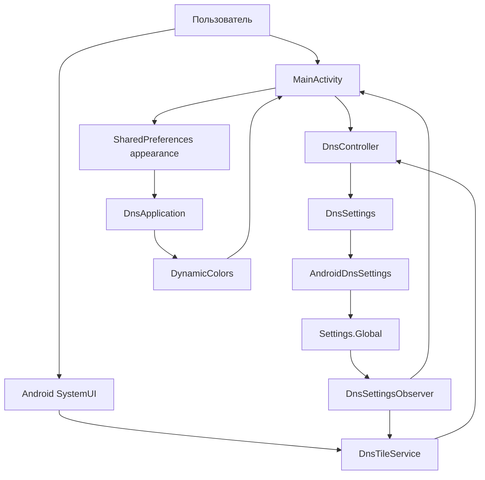

# Архитектура pDNS Auto Switch

Документ описывает текущую реализацию. Будущая автоматизация вынесена в [ROADMAP.md](ROADMAP.md).
Правила внесения изменений — в [AGENTS.md](AGENTS.md).

## Назначение и границы

Приложение управляет системным Android Private DNS: вручную переключает сохранённого
провайдера и выключенный режим кнопкой или плиткой Quick Settings **Smart DNS**.

Оно не является DNS-сервером, VPN или прокси, не резолвит запросы самостоятельно и не проверяет
доступность провайдера. Состояние «Включён» означает выбранный режим `hostname` в Android.
Мониторинга Wi-Fi, списка доверенных сетей, foreground service и автозапуска пока нет.

## Стек и сборка

| Параметр | Текущее значение |
|---|---|
| Модуль | `app` |
| Язык и UI | Kotlin, XML Views, AppCompat, Material 3 |
| Application ID / namespace | `io.github.sorjo.pdnsautoswitch` |
| Поддерживаемый минимум | Android 13 / API 33 |
| compileSdk / targetSdk | 37 / 37 |
| Android Gradle Plugin | 9.1.1, встроенная поддержка Kotlin |
| Gradle Wrapper | 9.3.1 |
| JVM для Gradle daemon | 25, задана в `gradle/gradle-daemon-jvm.properties` |
| Java / Kotlin bytecode target | 17 |
| Material Components | 1.13.0 |
| Тесты | JUnit 4.13.2, локальные JVM-тесты |

Версия APK задаётся в `app/build.gradle.kts`; не дублировать здесь историю версий.
Путь SDK локален для машины и находится в игнорируемом `local.properties`.
Release использует отдельный постоянный ключ: реквизиты читаются из внешнего файла,
заданного `PDNS_SIGNING_PROPERTIES`. Без него release не проходит проверку подписи.
Подробности — в [инструкции сборки](docs/release-build.md).

## Компоненты и связи

Исходники расположены в `app/src/main/java/io/github/sorjo/pdnsautoswitch/`.

| Компонент | Ответственность |
|---|---|
| `DnsController` | Читает состояние, определяет целевой режим, проверяет условия записи и её результат. Не зависит от Android API. |
| `DnsSettings` | Интерфейс чтения, записи и проверки разрешения; граница между логикой и Android. |
| `AndroidDnsSettings` | Реализует интерфейс через `Settings.Global` и проверку `WRITE_SECURE_SETTINGS`. |
| `DnsSettingsObserver` | Подписывается на изменения трёх DNS-ключей через `ContentObserver` на main looper. |
| `DnsTileService` | Показывает системное состояние, обрабатывает нажатие и разблокировку, направляет к настройке при ошибках. |
| `MainActivity` | Экран состояния и переключения, выдачи инструкции, добавления плитки и выбора палитры. |
| `DnsApplication` | Регистрирует применение динамической палитры к Activity с учётом настройки пользователя. |

DI-фреймворка, базы данных, навигационного графа и отдельных экранов сейчас нет.
Activity и плитка создают собственные экземпляры контроллера; общего локального флага DNS нет.

## Данные

### Системные настройки

| Ключ в `Settings.Global` | Использование |
|---|---|
| `private_dns_mode` | Чтение и запись текущего режима: `off`, `hostname`, `opportunistic`. |
| `private_dns_default_mode` | Только чтение: fallback, если явный режим отсутствует. |
| `private_dns_specifier` | Только чтение: сохранённое имя хоста провайдера. |

Если явный и default-режимы отсутствуют, контроллер трактует режим как `opportunistic`.
Неизвестное значение отображается как `UNKNOWN`, а не как подтверждённое выключение.

`DnsController.State` содержит `mode`, `provider`, `canWrite` и `readable`. Это снимок
системы на момент чтения, а не самостоятельное хранилище. При `SecurityException` чтения
возвращается нечитаемое состояние без возможности записи.

### Локальные данные

- `SharedPreferences` с именем `appearance`: Boolean `dynamic_color`, по умолчанию `true`.
- В `savedInstanceState` Activity сохраняется раскрытие настройки (`setup_expanded`).
- Адрес провайдера, текущий DNS-режим и разрешение не копируются в локальные настройки.
- Нет аккаунтов, доверенных SSID, истории сетей, диагностического журнала или серверного хранилища.

## Сценарий переключения

1. Activity или плитка вызывает `DnsController.toggle()`.
2. Контроллер заново читает состояние и проверяет доступность чтения и разрешение записи.
3. При текущем `HOSTNAME` целевой режим — `off`; при остальных режимах — `hostname`.
4. Для включения требуется непустой сохранённый провайдер. Для выключения это условие не нужно.
5. Записывается только `private_dns_mode`. Адрес провайдера не меняется.
6. Успех возвращается только если `write()` принят и повторное чтение подтверждает целевое значение.
7. UI заново считывает состояние; изменения также доходят через observer.

Результаты: `SUCCESS`, `MISSING_PERMISSION`, `MISSING_PROVIDER`, `READ_FAILED`, `WRITE_FAILED`.
Ошибка записи не маскируется успешным локальным переключением.

## Жизненный цикл

### Экран

`MainActivity` — `AppCompatActivity`. В `onResume()` включает observer и обновляет состояние,
в `onPause()` отписывается. Отступы учитывают системные панели и вырез экрана.
Настройка раскрывается по необходимости; ADB-команда скрывается после выдачи разрешения.
Системные настройки открываются через `Settings.ACTION_WIRELESS_SETTINGS`, с fallback на
общие настройки. Отдельный intent Private DNS на проверенном эмуляторе не поддерживается.

### Плитка

Используется обычный `TileService`, без `ACTIVE_TILE`: SystemUI вызывает `onStartListening()`
при показе панели. Тогда включается observer; в `onStopListening()` и `onDestroy()` он отключается.
Обновление `qsTile` выполняется только во время listening.

- `HOSTNAME` → активная плитка; `OFF`, `AUTOMATIC`, `UNKNOWN` → неактивная.
- Подпись уточняет режим или необходимость настройки; неизвестное состояние не называется «выключено».
- Нажатие вызывает тот же контроллер. При блокировке сначала используется `unlockAndRun`.
- Ошибки разрешения/провайдера/чтения открывают Activity; отказ записи также показывает сообщение.
- Для API 34+ используется `startActivityAndCollapse(PendingIntent)`, для API 33 — старый overload.
- Долгое нажатие маршрутизируется в Activity через `QS_TILE_PREFERENCES`.

Постоянный процесс не требуется. После его завершения очередной системный запуск компонента
снова читает настройки. Приложение не запускает polling, таймеры или фоновый мониторинг сети.

## Тема и ресурсы

`Theme.Material3.DayNight.NoActionBar` следует системной светлой/тёмной теме.
Бирюзовая базовая палитра находится в `res/values/colors.xml` и `res/values-night/colors.xml`.
Разметка использует семантические цветовые роли темы.

`DnsApplication` подключает `DynamicColors.applyToActivitiesIfAvailable()`. Precondition
проверяет `appearance.dynamic_color`. Выбор меняется `MaterialSwitch` на экране, сохраняется,
после чего Activity пересоздаётся. Приложение получает готовые системные цвета и не читает обои.
Внешний вид плитки в шторке контролируется SystemUI, а не темой Activity.

Визуальный ориентир — [LocalSend](https://github.com/localsend/localsend/blob/main/app/lib/config/theme.dart).
API динамических цветов описан в [Android Developers](https://developer.android.com/develop/ui/views/theming/dynamic-colors).

## Разрешения и границы доступа

- Собственное системное разрешение приложения — `WRITE_SECURE_SETTINGS`. Объявляется в manifest
  и выдаётся через ADB; обычного runtime-диалога для него нет.
- `DnsTileService` экспортирован с обязательным `BIND_QUICK_SETTINGS_TILE`; метаданные
  `TOGGLEABLE_TILE` включают поведение переключателя для accessibility.
- Activity экспортирована для launcher и открытия настроек плитки.
- Нет разрешений `INTERNET`, геолокации, foreground service и автозапуска.
- В объединённом manifest AndroidX также объявляет собственное signature-разрешение
  `DYNAMIC_RECEIVER_NOT_EXPORTED_PERMISSION`; это не доступ к пользовательским данным.
- `allowBackup=false` и `res/xml/data_extraction_rules.xml` задают текущие правила резервирования.

## Проверки

`DnsControllerTest` использует fake `DnsSettings`. 11 тестов покрывают сохранение провайдера,
переключение режимов, внешние изменения, fallback-режим, пустого провайдера, отсутствие/отзыв
разрешения, неизвестный режим и отказ/неподтверждение записи.

Результаты Android-проверок и оставшиеся сценарии — в [ROADMAP.md](ROADMAP.md) и
[чек-листе плитки](docs/manual-tile-checklist.md). JVM-тестов Activity/SystemUI нет;
эмулятор и физический Pixel не считаются взаимозаменяемыми источниками подтверждения.
