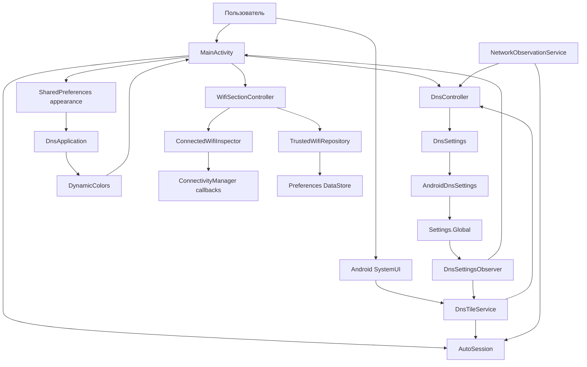

# Архитектура pDNS Auto Switch

Документ описывает текущую реализацию: ручное управление, наблюдение и явно включаемый Auto.

## Назначение и границы

Приложение управляет системным Android Private DNS: вручную переключает сохранённого
провайдера и выключенный режим кнопкой или плиткой Quick Settings **Smart DNS**.

Оно не является DNS-сервером, VPN или прокси, не резолвит запросы самостоятельно и не проверяет
доступность провайдера. Состояние «Включён» означает выбранный режим `hostname` в Android.
Есть проверка Wi-Fi по кнопке, локальный список доверенных SSID и вручную запускаемый сервис событий с журналом рекомендаций. При выключенном Auto он не меняет DNS; после boot не запускается.

## Стек и сборка

| Параметр | Текущее значение |
|---|---|
| Модуль | `app` |
| Язык и UI | Kotlin, XML Views, AppCompat, Material 3 |
| Application ID / namespace | `io.github.sorjo.pdnsautoswitch` |
| Поддерживаемый минимум | Android 13 / API 33 |
| compileSdk / targetSdk | 37 / 37 |
| Android Gradle Plugin | 9.1.1, встроенная поддержка Kotlin |
| Gradle Wrapper | 9.3.1 |
| JVM для Gradle daemon | 25, задана в `gradle/gradle-daemon-jvm.properties` |
| Java / Kotlin bytecode target | 17 |
| Material Components | 1.13.0 |
| Тесты | JUnit 4.13.2, локальные JVM-тесты |
| Хранилище доверенных сетей | Preferences DataStore 1.2.1 |

Версия APK задаётся в `app/build.gradle.kts`; не дублировать здесь историю версий.
Путь SDK локален для машины и находится в игнорируемом `local.properties`.
Release использует отдельный постоянный ключ: реквизиты читаются из внешнего файла,
заданного `PDNS_SIGNING_PROPERTIES`. Без него release не проходит проверку подписи.
Подробности — в [инструкции сборки](docs/release-build.md).

## Компоненты и связи

Исходники расположены в `app/src/main/java/io/github/sorjo/pdnsautoswitch/`.

| Компонент | Ответственность |
|---|---|
| `DnsController` | Читает состояние, определяет целевой режим, проверяет условия записи и её результат. Не зависит от Android API. |
| `DnsSettings` | Интерфейс чтения, записи и проверки разрешения; граница между логикой и Android. |
| `AndroidDnsSettings` | Реализует интерфейс через `Settings.Global` и проверку `WRITE_SECURE_SETTINGS`. |
| `DnsSettingsObserver` | Подписывается на изменения трёх DNS-ключей через `ContentObserver` на main looper. |
| `DnsTileService` | Показывает системное состояние, обрабатывает нажатие и разблокировку, направляет к настройке при ошибках. |
| `MainActivity` | Экран состояния и переключения, выдачи инструкции, добавления плитки и выбора палитры. |
| `DnsApplication` | Регистрирует применение динамической палитры к Activity с учётом настройки пользователя. |

`WifiSectionController` управляет проверкой, runtime-разрешением и списком в Activity.
`ConnectedWifiInspector` регистрирует callback только на короткое окно проверки (2 секунды),
использует `FLAG_INCLUDE_LOCATION_INFO` и `WifiInfo` из `NetworkCapabilities.transportInfo`.
Запрос ограничен физическими Wi-Fi (`NOT_VPN`), не создаёт соединение и не сканирует эфир.
Обрабатываются `onAvailable`, `onCapabilitiesChanged` и `onLost`; результат может содержать
несколько сетей или скрытые SSID. Это диагностический снимок, не выбор сети для будущего Auto.
Проверка отменяется в `onPause`, её UI-контроллер и coroutine scope закрываются в `onDestroy`.

`WifiSsid` снимает только внешние framework-кавычки, отбрасывает пустое/неизвестное имя,
сохраняет регистр и пробелы. Repository принимает уже декодированные SSID и не нормализует их повторно.
Перед добавлением сеть проверяется снова, чтобы отсеять устаревший результат. Удаление подтверждается.
Список доверенных SSID также используется политикой сервиса Auto.

DI-фреймворка, базы данных, навигационного графа и отдельных экранов сейчас нет.
Activity и плитка создают собственные экземпляры контроллера; общего локального флага DNS нет.

## Данные

### Системные настройки

| Ключ в `Settings.Global` | Использование |
|---|---|
| `private_dns_mode` | Чтение и запись текущего режима: `off`, `hostname`, `opportunistic`. |
| `private_dns_default_mode` | Только чтение: fallback, если явный режим отсутствует. |
| `private_dns_specifier` | Только чтение: сохранённое имя хоста провайдера. |

Если явный и default-режимы отсутствуют, контроллер трактует режим как `opportunistic`.
Неизвестное значение отображается как `UNKNOWN`, а не как подтверждённое выключение.

`DnsController.State` содержит `mode`, `provider`, `canWrite` и `readable`. Это снимок
системы на момент чтения, а не самостоятельное хранилище. При `SecurityException` чтения
возвращается нечитаемое состояние без возможности записи.

### Локальные данные

- `SharedPreferences` с именем `appearance`: Boolean `dynamic_color`, по умолчанию `true`.
- В `savedInstanceState` Activity сохраняется раскрытие настройки (`setup_expanded`).
- Адрес провайдера, текущий DNS-режим и разрешение не копируются в локальные настройки.
- Preferences DataStore `trusted_wifi`: StringSet `trusted_ssids`, по умолчанию пустой.
  Singleton задаётся extension-делегатом в `WifiDataStore.kt`, используется application context.
  Файл расположен в приватном `files/datastore/trusted_wifi.preferences_pb` и исключён из backup/transfer.
  Сохраняются только явно добавленные имена; BSSID, UUID, координаты и история не собираются.
- Результат проверки SSID существует только в памяти экрана и сбрасывается при уходе с него.
- Нет аккаунтов, серверного хранилища и сохранённой истории имён сетей. Отдельный ограниченный журнал диагностики описан ниже.

## Сценарий переключения

1. Activity или плитка ставит активный Auto на паузу и вызывает `DnsController.toggle()`.
2. Контроллер заново читает состояние и проверяет доступность чтения и разрешение записи.
3. При текущем `HOSTNAME` целевой режим — `off`; при остальных режимах — `hostname`.
4. Для включения требуется непустой сохранённый провайдер. Для выключения это условие не нужно.
5. Записывается только `private_dns_mode`. Адрес провайдера не меняется.
6. Успех возвращается только если `write()` принят и повторное чтение подтверждает целевое значение.
7. UI заново считывает состояние; изменения также доходят через observer.

Результаты: `SUCCESS`, `MISSING_PERMISSION`, `MISSING_PROVIDER`, `READ_FAILED`, `WRITE_FAILED`.
Ошибка записи не маскируется успешным локальным переключением.

## Жизненный цикл

### Экран

`MainActivity` — `AppCompatActivity`. В `onResume()` включает observer и обновляет состояние,
в `onPause()` отписывается. Отступы учитывают системные панели и вырез экрана.
Настройка раскрывается по необходимости; ADB-команда скрывается после выдачи разрешения.
Системные настройки открываются через `Settings.ACTION_WIRELESS_SETTINGS`, с fallback на
общие настройки. Отдельный intent Private DNS на проверенном эмуляторе не поддерживается.

### Плитка

Используется обычный `TileService`, без `ACTIVE_TILE`: SystemUI вызывает `onStartListening()`
при показе панели. Тогда включается observer; в `onStopListening()` и `onDestroy()` он отключается.
Обновление `qsTile` выполняется только во время listening.

- `HOSTNAME` → активная плитка; `OFF`, `AUTOMATIC`, `UNKNOWN` → неактивная.
- Подпись уточняет режим или необходимость настройки; неизвестное состояние не называется «выключено».
- Нажатие ставит активный Auto на паузу выбранной длительности и вызывает тот же контроллер. При блокировке сначала используется `unlockAndRun`.
- Ошибки разрешения/провайдера/чтения открывают Activity; отказ записи также показывает сообщение.
- Для API 34+ используется `startActivityAndCollapse(PendingIntent)`, для API 33 — старый overload.
- Долгое нажатие маршрутизируется в Activity через `QS_TILE_PREFERENCES`.

Постоянный процесс не требуется. После его завершения очередной системный запуск компонента
снова читает настройки. Плитка не запускает polling, таймеры и сервис наблюдения. Сервис диагностики управляется отдельно пользователем.

## Тема и ресурсы

`Theme.Material3.DayNight.NoActionBar` следует системной светлой/тёмной теме.
Бирюзовая базовая палитра находится в `res/values/colors.xml` и `res/values-night/colors.xml`.
Разметка использует семантические цветовые роли темы.

`DnsApplication` подключает `DynamicColors.applyToActivitiesIfAvailable()`. Precondition
проверяет `appearance.dynamic_color`. Выбор меняется `MaterialSwitch` на экране, сохраняется,
после чего Activity пересоздаётся. Приложение получает готовые системные цвета и не читает обои.
Внешний вид плитки в шторке контролируется SystemUI, а не темой Activity.

Визуальный ориентир — [LocalSend](https://github.com/localsend/localsend/blob/main/app/lib/config/theme.dart).
API динамических цветов описан в [Android Developers](https://developer.android.com/develop/ui/views/theming/dynamic-colors).

## Разрешения и границы доступа

- Собственное системное разрешение приложения — `WRITE_SECURE_SETTINGS`. Объявляется в manifest
  и выдаётся через ADB; обычного runtime-диалога для него нет.
- `DnsTileService` экспортирован с обязательным `BIND_QUICK_SETTINGS_TILE`; метаданные
  `TOGGLEABLE_TILE` включают поведение переключателя для accessibility.
- Activity экспортирована для launcher и открытия настроек плитки.
- Для проверки Wi-Fi добавлены `ACCESS_NETWORK_STATE`, `ACCESS_WIFI_STATE`,
  `ACCESS_COARSE_LOCATION`, `ACCESS_FINE_LOCATION`. Точная геопозиция запрашивается после нажатия проверки или запуска наблюдения; `COARSE` и `FINE` запрашиваются вместе по правилам Android.
  Координаты и сканирование не запрашиваются. Выключенная Location, отказ и redaction
  показаны отдельно. Нет `ACCESS_BACKGROUND_LOCATION` и `NEARBY_WIFI_DEVICES`.
- Нет разрешений `INTERNET` и автозапуска. Диагностика объявляет `FOREGROUND_SERVICE` и `FOREGROUND_SERVICE_LOCATION`; `POST_NOTIFICATIONS` не запрашивается.
- В объединённом manifest AndroidX также объявляет собственное signature-разрешение
  `DYNAMIC_RECEIVER_NOT_EXPORTED_PERMISSION`; это не доступ к пользовательским данным.
- `allowBackup=false` и `res/xml/data_extraction_rules.xml` задают текущие правила резервирования.

## Проверки

`DnsControllerTest` использует fake `DnsSettings`. 11 тестов покрывают сохранение провайдера,
переключение режимов, внешние изменения, fallback-режим, пустого провайдера, отсутствие/отзыв
разрешения, неизвестный режим и отказ/неподтверждение записи.

Оставшиеся сценарии описаны в
[чек-листе плитки](docs/manual-tile-checklist.md). JVM-тестов Activity/SystemUI нет;
эмулятор и физический Pixel не считаются взаимозаменяемыми источниками подтверждения.

`WifiSsidTest` и `TrustedWifiRepositoryTest` дополняют тесты DNS: проверяются framework-кавычки,
скрытые имена, регистр, Unicode, значимые пробелы, дубликаты, удаление и сохранение после открытия
нового экземпляра DataStore. Эти компоненты покрыты 16 JVM-тестами; политика, журнал, окно стабилизации и Auto покрыты отдельными тестами.
Android-проверки Wi-Fi: [чек-лист](docs/manual-wifi-checklist.md).

Основания выбора API: [WifiInfo](https://developer.android.com/reference/android/net/wifi/WifiInfo),
[NetworkCallback](https://developer.android.com/reference/android/net/ConnectivityManager.NetworkCallback).

## Диагностическое наблюдение за сетью

Реализованный поток: `NetworkMonitor → NetworkTracker → NetworkSnapshot → PolicyEvaluator → ObservationRepository → UI`.
`PolicyEvaluator` остаётся чистым вычислителем. После окна стабилизации сервис может передать
его решение в `AutoSession → DnsController.applyMode`, только если пользователь явно включил Auto.
Без Auto сервис остаётся диагностическим. Кнопка и плитка перед ручным toggle ставят активный Auto на паузу.

### Жизненный цикл

`NetworkObservationService` запускается кнопкой из видимой Activity. Это неэкспортируемый
foreground service типа `location` с `FOREGROUND_SERVICE_LOCATION`. Перед запуском проверяются точное runtime-разрешение и включённое системное местоположение. Координаты не запрашиваются. Нет `ACCESS_BACKGROUND_LOCATION`; сервис запускается только из видимой Activity. Вызывает `startForeground()`
с тихой Notification и действием остановки. На API 33 используется обычный overload, на 34+ —
overload с типом FGS. `POST_NOTIFICATIONS` не объявлено: отдельного запроса уведомлений нет,
но сервис остаётся видимым в системном списке активных приложений.

`START_NOT_STICKY`, без boot receiver и без сохранённого флага автозапуска. Выход из Activity
не останавливает явно запущенное наблюдение. Кнопка остановки или системная остановка завершает
сервис; при обычном `onDestroy` отменяются scope, callbacks, receiver и content observer.
После принудительного завершения процесса `onDestroy` может не вызываться: отсутствие записи
`SERVICE_STOPPED` не доказывает, что сервис продолжает работать. Новый процесс начинает со статуса STOPPED.

Подписки:

- default network callback и отдельный callback физических Wi-Fi с `FLAG_INCLUDE_LOCATION_INFO`;
- DataStore доверенных сетей;
- изменение `private_dns_specifier` через ContentObserver;
- системная Location, включение/выключение экрана и видимость Activity.

`NetworkMonitor` не выполняет polling, сканирование, соединение с Wi-Fi и сетевые запросы.
Настройки периода нет, поскольку подписка поддерживается. При смене видимости/доступа к location
подписки пересоздаются, чтобы получить свежие отредактированные системой capabilities.
Номер поколения отсекает поздние callbacks старой подписки; кэш SSID при этом сбрасывается.

### Выбор сети и рекомендации

По уточнению владельца отдельной проверки/блокировки по VPN в диагностическом сервисе нет.
Подключённый физический Wi-Fi имеет приоритет, независимо от overlay/default-сети.
Один Wi-Fi выбирается непосредственно; при нескольких кандидатах используется известный
default handle, если он относится к одному из них, иначе фиксируется AMBIGUOUS.
Физический callback фильтруется `NOT_VPN`, чтобы получать Wi-Fi, а не overlay; это не запрет работы с VPN.

`NetworkTracker` хранит временные Android handles только в памяти. Потеря сети аннулирует
SSID, а запоздалые capabilities потерянного подключения не восстанавливают доверие.
`PolicyEvaluator` — чистая функция:

| Состояние | Рекомендация |
|---|---|
| Свежий читаемый SSID есть в доверенном списке | OFF |
| Недоверенный Wi-Fi, mobile, Ethernet, отсутствие сети | HOSTNAME |
| Скрытый SSID, нет точного разрешения, Location off, загрузка/ошибка списка, несколько неоднозначных Wi-Fi, начальный PENDING | HOSTNAME с причиной неопределённости |
| Для HOSTNAME не задан/не читается провайдер | BLOCKED, желаемое состояние остаётся HOSTNAME |

Невалидированный интернет сам по себе не отменяет доверие к известному Wi-Fi: иначе проблема
Private DNS дома могла бы мешать выбрать нужную рекомендацию. `validated` и `portal` отражаются в журнале.
Отсутствие права записи DNS не мешает диагностике; оно отображается как метаданные.
Ни OFF, ни HOSTNAME в журнале не означают, что настройка применена.

### Журнал и UI

`ObservationRepository` — process singleton с одним IO writer и StateFlow для UI. История
сохраняется через `ObservationLog` в `noBackupFilesDir/network-observation.log`, отдельно от
доверенных SSID. До 2500 строк, нет backup/transfer. Обычные записи дописываются и закрываются по мере поступления; при переполнении атомарно удаляется старейшая десятая часть. После загрузки файла первая запись атомарно нормализует историю, удаляя повреждённые строки. Полный файл не перечитывается и не переписывается на каждом событии. Не сохраняются
SSID, BSSID, IP, координаты, имена провайдера или Android network handles. В Logcat приложение
события сети не выводит. Экспорт происходит только по кнопке сохранения в «Загрузки».

Формат каждой строки: `timestamp - net condition - recommendation`.
Timestamp — ISO 8601 с часовым смещением устройства. Condition включает тип сети, доступность
SSID и доверие (без имени), `ui`, `screen`, событие, `elapsed_ms`, признаки валидации и разрешения.
Recommendation содержит OFF/HOSTNAME/BLOCKED, desired, reason и `diagnostic_only`.
Lifecycle-события имеют рекомендацию NONE. Повторные callbacks без значимого изменения
снимка/условий не создают одинаковые записи.

`ObservationPresence` фиксирует видимость Activity в момент события. `PowerManager.isInteractive`
фиксирует состояние экрана. `elapsed_ms` позволяет сопоставлять порядок событий при изменениях
настенных часов. Это не доказательство отсутствия системных задержек доставки callbacks.

`ObservationSectionController` показывает статус, запуск/остановку, переключатель записи, сохранение файла и подтверждаемую очистку. Сами строки в UI не выводятся. `observation.logging_enabled` хранится в SharedPreferences, по умолчанию true для диагностического этапа. Отключение записи не останавливает наблюдение и не стирает историю. Очистка не меняет доверенные сети
и не останавливает сервис. Ошибка записи отображается отдельно. Статус запуска не восстанавливается из файла.

### Устойчивые рекомендации, сохранение и экспорт

Исходные события имеют `stage=RAW`. `RecommendationWindow` и отменяемая coroutine формируют
`stage=STABLE` после 750 мс без значимых изменений. Любой новый снимок заменяет ожидающую
рекомендацию; потерянный/скрытый SSID не сохраняет доверие. При остановке coroutine отменяется.
Это однократная задержка, а не polling. При активном Auto устойчивая рекомендация применяется отдельно через DnsController.

Журнал не очищается при старте. `onDestroy` ставит SERVICE_STOPPED и FIFO-барьер в очередь IO,
ожидает максимум одну секунду, затем writer выполняет `FileDescriptor.sync()`. Это best effort:
Android может убить процесс без onDestroy, а ещё не обработанные записи при этом могут потеряться.
Уже записанные строки сохраняются. При переполнении удаляются только самые старые записи.

`ObservationExport` получает согласованный снимок после всех предшествующих команд writer.
Через MediaStore.Downloads создаётся UTF-8 файл `pDNS auto switcher.log`: сначала IS_PENDING=1,
затем после закрытия потока IS_PENDING=0. Неудачный экспорт удаляет незавершённый файл.
Экспорт выполняется только кнопкой, вне main thread. Отдельного разрешения хранения нет.
Android может добавлять номер повторному имени; существующие экспорты не перезаписываются.

### Подтверждение и ограничения

Лог владельца от 19 октября подтвердил работу specialUse-сервиса после закрытия приложения,
но показал длительный `SSID_UNAVAILABLE` в фоне и возврат доверия при открытии Activity.
Поэтому тип сервиса исправлен на location; результаты прежнего specialUse не являются проверкой фикса.
Лог Pixel 20 октября подтвердил новый location-сеанс с 00:10:29 до 19:52:30, свежие фоновые SSID и переходы доверенный → недоверенный → доверенный. Low-memory/system kill остаются непроверенными.
36 JVM-тестов покрывают прежние компоненты, 750-мс окно, большую историю и повреждённый хвост файла.
Автоматическое применение и настраиваемая ручная пауза реализованы; boot остаётся отдельным этапом.

На эмуляторе Android 17 после исправления проверены новое подключение Wi-Fi при ui=BACKGROUND
и screen=OFF с ssid=READABLE и устойчивой OFF для доверенной сети, экспорт с расширением .log,
отключение записи, SERVICE_STOPPED после flush и сохранность истории при force-stop/relaunch.
Фактические DNS mode/provider не менялись. Это не заменяет суточный тест на Pixel.

## Auto и ручная пауза

`AutoSession` хранит process-local StateFlow: enabled, ошибку и монотонный срок паузы.
Флаг и пауза не сохраняются на диск: новый процесс начинает с Auto OFF. Явный старт из видимой
Activity отправляет внутренний ACTION_ENABLE_AUTO неэкспортируемому location-сервису.
Старт без Auto по-прежнему доступен. START_NOT_STICKY, boot и восстановление не добавлены.

Включение проверяет читаемость DNS, WRITE_SECURE_SETTINGS и непустого провайдера.
После 750 мс сервис повторно сверяет снимок, доступ, список доверия, наличие провайдера и право
записи. Изменившиеся данные отправляются на новое согласование. Поздние callbacks старых
поколений и потерянных Wi-Fi отсекаются NetworkMonitor/NetworkTracker.
`applyMode(OFF/HOSTNAME)` идемпотентен, пишет только private_dns_mode и проверяет прочитанный
режим и сохранность провайдера. Ошибка выключает Auto без циклических повторов.
Изменения системных DNS-ключей наблюдаются и запускают согласование; собственная запись
может вызвать повторную проверку, но не повторную запись уже правильного режима.
Отзыв разрешения проверяется при следующих событиях/перед применением; периодического опроса нет.

Кнопка и плитка сначала ставят активный Auto на паузу до elapsedRealtime + pauseMinutes × 60000, затем
вызывают ручной toggle. Каждое ручное нажатие обновляет срок. Сетевые callbacks, смена экрана
и изменения DNS паузу не отменяют. Во время паузы наблюдение/журнал продолжаются без Auto-записей.
Однократная coroutine ждёт срок; сетевое/экранное событие также проверяет истечение монотонного
срока. После истечения подписки создаются заново, а запись ждёт свежего устойчивого снимка.
В глубоком сне Android может отложить coroutine до пробуждения: wake lock, polling и будильник
не добавлены. Пауза не заканчивается раньше выбранного срока. Остановка сервиса выключает Auto
и отменяет ожидания. Выключение Auto не восстанавливает какой-либо старый DNS-режим.

Плитка сохраняет отображение фактического DNS и дополняет подпись Auto/пауза. UI показывает
время окончания паузы и ошибки. Notification различает диагностику, Auto и паузу.
RAW/STABLE остаются рекомендациями с diagnostic_only; отдельный AUTO_APPLY содержит desired,
actual и result без имени провайдера. Системный hostname локально не дублируется.

`AutoSessionTest` содержит 9 JVM-сценариев: идемпотентные записи, условия включения Auto,
ручная пауза и её истечение, продление/отмена паузы, ошибки/отзыв разрешения и гонка провайдера.
Всего 46 JVM-тестов. Debug/release и Lint проходят: 0 ошибок, 11 предупреждений в обоих вариантах.

### Выбор длительности и лимит журнала

Доступны строго 1, 5, 10, 15, 20, 25 и 30 минут; по умолчанию 10. Material dropdown
в карточке наблюдения сохраняет выбор в SharedPreferences auto_settings.pause_minutes.
DnsApplication восстанавливает настройку до создания Activity или плитки; ошибочное значение
заменяется на 10. Сам Auto и активный срок не сохраняются. Изменение выбора не меняет уже
идущую паузу: новое значение используется при следующем ручном нажатии. Во время паузы
сервис продолжает наблюдение и журнал, приостановлены только автоматические изменения DNS.
Событие AUTO_PAUSED содержит duration_minutes.

ObservationLog при загрузке оставляет последние 2500 корректных строк. Если старый файл
длиннее, он атомарно сокращается сразу, даже без нового события. При следующем переполнении
удаляются 250 самых старых строк. Это лимит количества, не обещание хранения ровно 24 часов.

Проверка на эмуляторе Android 17: все семь вариантов доступны и выбираются; настройка
восстанавливается в новом процессе при Auto OFF. Изменение 1 → 30 минут не сдвигает активный
срок. Реальная минутная пауза завершилась через 60016 мс при BACKGROUND/SCREEN_OFF, затем
получены новые callbacks и STABLE перед применением OFF. Следующее ручное нажатие создало
30-минутную паузу. Загрузка старого файла из 5010 строк оставила на диске последние 2500
без новых сетевых событий. Поле просмотрено в светлой/тёмной теме с базовой и динамической палитрой.
Для 0.3.5 прошли 46 JVM-тестов, debug/release и Lint: 0 ошибок, 11 предупреждений.
